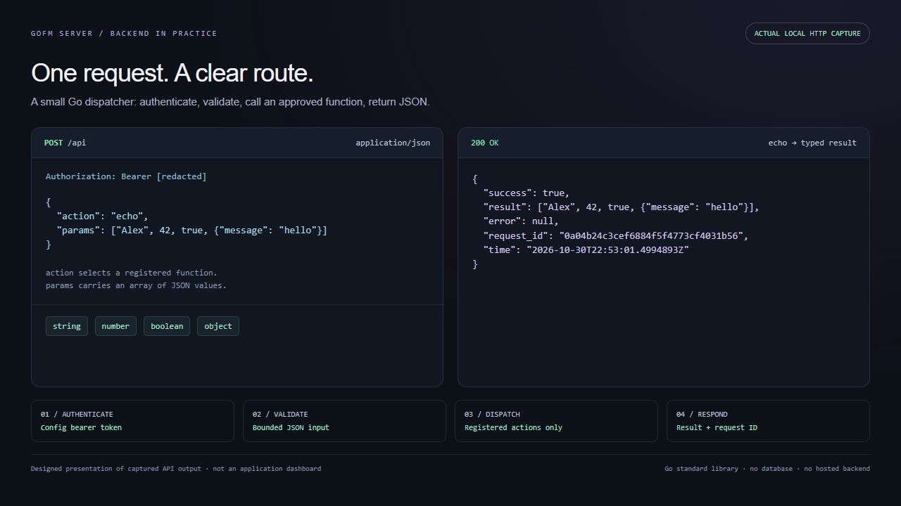
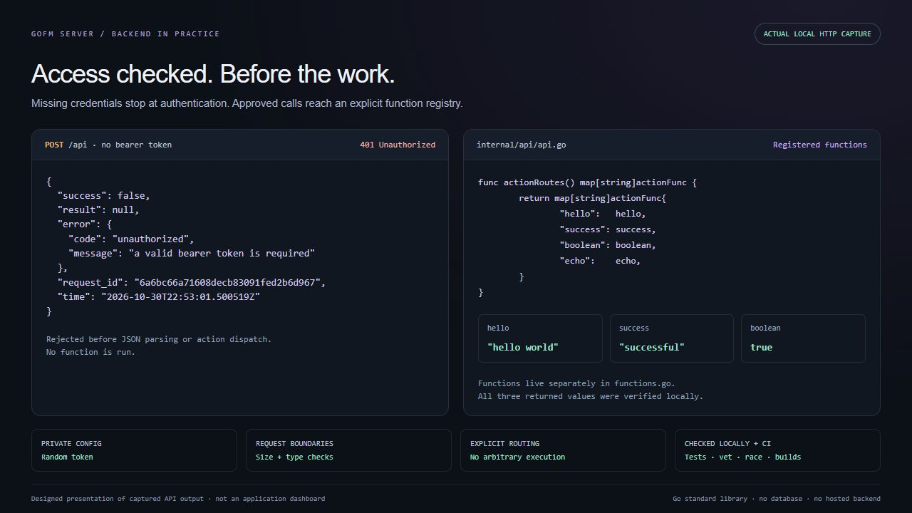

# goFM Server

A Go HTTP server that routes authenticated JSON requests to named functions.
I built it as a small starting point for integration work: a clear request
contract, a private config token, and functions that are easy to read and change.
The default dispatcher uses only Go's standard library and needs no database or
external service. The current examples return dummy values; they do not connect
to FileMaker.

## Start locally (Go)

Install Go first. The module declares Go 1.25; the current checks use Go 1.26.
Clone the public repository, or download and extract its
[source ZIP](https://github.com/alexrgcdata/goFM-Server/archive/refs/heads/main.zip)
and open a terminal in the extracted project folder.

```sh
git clone https://github.com/alexrgcdata/goFM-Server.git
cd goFM-Server
```

From the project root:

```sh
go run ./cmd/gofm-server -init-config
go run ./cmd/gofm-server
```

The first command creates ignored `config.local.json` with a random 256-bit
bearer token and a loopback listener at `127.0.0.1:8080`. It never prints the
token or overwrites an existing file. If the port is occupied, edit `address`
in that private file. `-config <path>` selects another private config location.
Keep real config files out of Git and outside any public web root. Unix files
are created with mode 0600; on Windows keep the folder's access permissions
restricted to the account running the server. The empty token in
`config.example.json` is documentation only and will not start a server.

In a second PowerShell window, from the same folder:

```powershell
./scripts/demo.ps1
```

This reads the token privately, checks health, calls all four actions, validates
the results, and verifies a missing token receives HTTP 401. The default demo URL
is `http://127.0.0.1:8080`; use `-BaseUrl` if you changed the listener.
The Go commands work on Windows, macOS, and Linux. The demo script requires
PowerShell. To check health from another terminal on any platform, open
`http://127.0.0.1:8080/health` in a browser or run:

```sh
curl http://127.0.0.1:8080/health
```

Use your own local token in the Authorization header for authenticated requests.
Stop the server with Ctrl+C; it allows up to ten seconds for active requests.

## Request and response

`POST /api` requires `Content-Type: application/json` and an
`Authorization: Bearer <your private config token>` header. Authentication runs
before JSON parsing or action execution. `GET /health` is intentionally public.

```json
{
  "action": "echo",
  "params": ["Alex", 42, true, {"message": "hello"}],
  "time": "2026-10-30T12:00:00Z"
}
```

`action` is required and case-sensitive. `params` must be an array, including
`[]` for functions with no arguments. Each function validates its own arguments.
`time` is an optional RFC3339 client timestamp, never authentication or trusted
server time. Unknown envelope fields and trailing JSON values are rejected.

```json
{
  "success": true,
  "result": ["Alex", 42, true, {"message": "hello"}],
  "error": null,
  "request_id": "a generated request identifier",
  "time": "2026-10-30T12:00:00Z"
}
```

Response time is generated by the server in UTC. `X-Request-ID` matches the
response identifier. An error uses `success: false`, `result: null`, and an
`error` object containing a stable `code` and a safe `message`.

| Action | Parameters | Result |
| --- | --- | --- |
| `hello` | `[]` | `"hello world"` |
| `success` | `[]` | `"successful"` |
| `boolean` | `[]` | `true` (JSON boolean) |
| `echo` | Any JSON array | The same array, preserving JSON types and numbers |

HTTP errors: 400 invalid JSON/parameters/time, 401 invalid or missing token,
404 unknown route/action, 405 wrong method, 413 oversized body, 415 wrong media
type, 500 internal action error. The default body limit is 64 KiB; config allows
1 KiB through 1 MiB. Internal error details and tokens are never returned.

## The backend in practice

These are designed presentations of actual HTTP responses captured from the
locally running dispatcher, with synthetic input and the bearer token redacted.
They are not screenshots of a dashboard or a public hosted API.





## Where to work

- `internal/api/api.go`: commented HTTP routes, request/response types, auth,
  validation, and the complete action allow-list (`actionRoutes`).
- `internal/api/functions.go`: the four demo functions and safe parameter errors.
- `internal/api/config.go`: private config loading and startup validation.
- `cmd/gofm-server/main.go`: config generation, listener timeouts, and shutdown.
- `scripts/demo.ps1`: live local demo without displaying credentials.

To add a function, give it the existing `(context.Context, []json.RawMessage)
(any, error)` signature, validate its parameters, and register its action name
in `actionRoutes`. The context carries cancellation when the caller disconnects.
Return `ParamsError` for safe caller validation messages; other errors get a
generic HTTP 500. Do not accept executable names, arbitrary code, or upstream
URLs from callers. Actions are compiled into the server; restart after changes.

## Checks and build (Go)

```powershell
go test ./...
go vet ./...
go build -trimpath -o ./bin/gofm-server.exe ./cmd/gofm-server
./bin/gofm-server.exe
```

There is **no Go `dist` folder**. This Windows executable is
`bin/gofm-server.exe` relative to your clone; run it from the
repository root so it finds `config.local.json`, or pass an explicit `-config`.
The executable does not embed or copy the token/config. A Linux build is:

```powershell
$env:GOOS='linux'
$env:GOARCH='amd64'
go build -trimpath -o ./bin/gofm-server-linux-amd64 ./cmd/gofm-server
Remove-Item Env:GOOS
Remove-Item Env:GOARCH
```

No deployment is performed by these commands. A hosted Go process needs a private
application directory outside the document root and HTTPS termination before
remote bearer-token use. The host-specific private destination has not been
selected. Keep the loopback default for local work. CORS is not enabled; the
older browser client is not part of this minimal API demo.

## Older gateway code

The previous proxy, FileMaker adapters, credential vault, SQLite storage,
admin API, and React dashboard are retained as legacy work. The minimal server
does not initialize or depend on them at runtime. Their original entry point is
`cmd/legacy-gateway`, with `config.legacy.example.json`; they are not configured
by the minimal server's config. Existing Go module dependencies remain for those
legacy packages and their tests. Older guides and React assets describe that
separate gateway, not the default dispatcher. See
[legacy overview](docs/LEGACY_GATEWAY.md). The historical committed config was
removed from tracking; the current server uses a newly generated token.

## Checks and remaining work

GitHub Actions runs formatting, `go vet ./...`, the full test suite, race checks
for the dispatcher and CLI, and Linux/Windows builds. The local demo also checks
real HTTP requests against the compiled Windows server. See
[the verification receipt](READINESS.md) for checked revisions and boundaries.

This is a local demo with a shared token, not an audited production service.
FileMaker delivery is the next proposed feature: send a JSON package to a chosen
OData field, then optionally call an approved script. That flow is not implemented
in the default dispatcher. Writes and script execution will need separate outcomes
so a script failure does not encourage duplicate deliveries.

See [the expansion plan](docs/EXPANSION.md) for later options. No hosted backend,
per-user permissions, persistent jobs, or automatic retries are provided today.
There is no versioned binary release; GitHub's ZIP contains source code.
